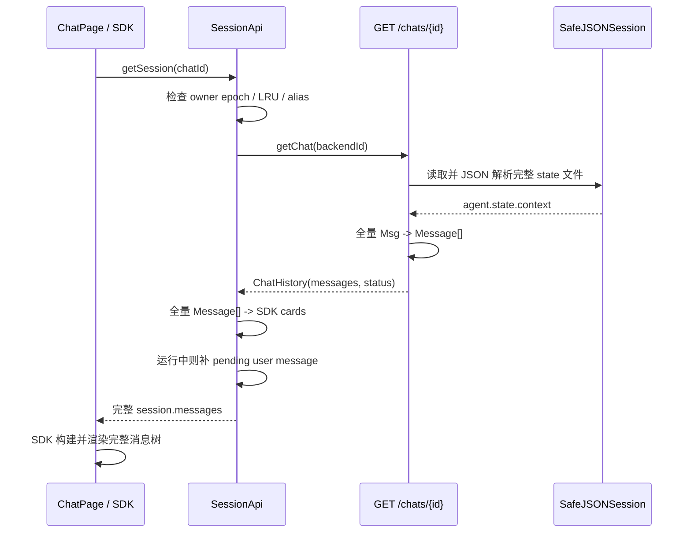
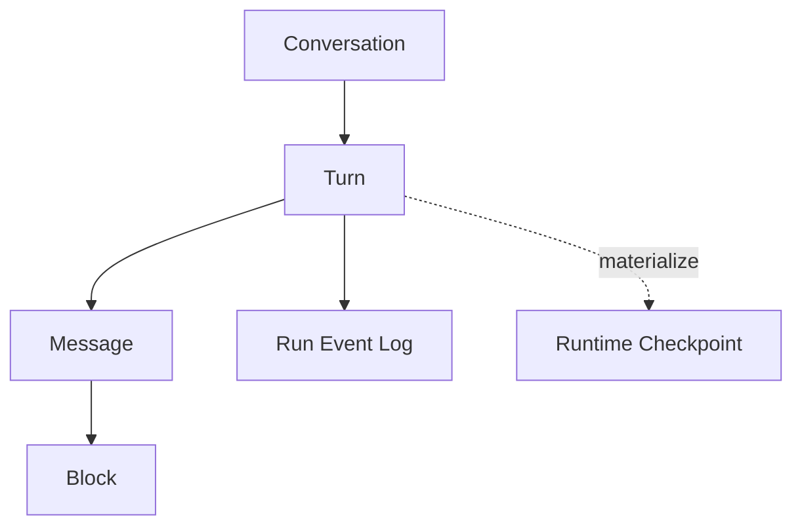

# QwenPaw Console Chat 当前架构分析

> 分析日期：2026-10-22
> 分析范围：`console/src/pages/Chat`、Console Chat API、Chat 元数据、
> AgentScope session 持久化、实时流、工具消息渲染及相关测试。
> 方法：源码静态分析 + 定点测试；未执行全量 build/test。

## 1. 结论摘要

当前 Console Chat 是一个“前端 SDK 会话视图 + 后端 AgentScope 全量状态快照 +
进程内 SSE 任务缓冲”的三层系统：

1. Chat 元数据由 `ChatSpec` 管理，负责 UUID、名称、分组、归档、状态和
   `session_id` 映射。
2. 消息历史不是独立消息表，而是保存在每个 session 的 AgentScope agent
   state JSON 中；读取 Chat 时加载整份 JSON、提取完整 context，再转换成前端
   SDK card。
3. 正在执行的 turn 由内存 `TaskTracker` 管理；SSE 断开后任务继续执行，重连时
   回放该 turn 自启动以来的全部内存事件，然后接续实时事件。

现有实现已经覆盖线性多轮对话、流式文本、工具调用、附件、取消、运行中重连、
失败/取消 turn 保存、消息队列、多 Tab 所有权、会话列表与 LRU 缓存等复杂行为。
但其基础数据模型仍是线性的、快照式的：没有持久化的 turn/message/block 实体，
没有历史分页和流事件游标，也没有会话分支。因此后续重构不能只在现有
`messages[]` 上补字段，需要新增服务端规范化存储与兼容投影层。

## 2. 系统边界与组件图

```mermaid
flowchart LR
    U[用户 / Console Chat] --> P[ChatPage<br/>页面编排]
    P --> SDK[@agentscope-ai/chat<br/>会话与流式 UI]
    P --> SA[SessionApi singleton<br/>身份映射/缓存/历史转换]
    P --> Q[Zustand stores<br/>队列/会话列表/注意力状态]

    SA --> CA[GET/POST /api/chats]
    P --> CC[POST /api/console/chat<br/>SSE]
    P --> CS[POST /api/console/chat/stop]

    CA --> CM[ChatManager]
    CM --> CR[chats JSON<br/>ChatSpec/Group 元数据]

    CA --> SS[SafeJSONSession]
    SS --> SF[sessions/channel/*.json<br/>完整 agent state]

    CC --> RT[Console router]
    RT --> TT[TaskTracker<br/>内存 task/queue/buffer]
    TT --> CH[ConsoleChannel.stream_one]
    CH --> AR[Agent runtime / hooks]
    AR --> SS
    CH --> TT
    TT --> SDK
```

### 2.1 前端职责

| 组件 | 位置 | 当前职责 |
|---|---|---|
| `ChatPage` | `console/src/pages/Chat/index.tsx:1294` | 页面总编排、请求构造、SSE 解析、重连、停止、队列、多 Tab、审批、附件、模型与项目目录控制 |
| `SessionApi` | `console/src/pages/Chat/sessionApi/index.ts:541` | SDK session adapter、Chat UUID / runtime session_id / 本地临时 ID 映射、全量历史加载与转换、LRU 缓存、运行中用户消息补丁 |
| `HostResponseCard` | `console/src/pages/Chat/HostBubbles.tsx` | assistant/tool/reasoning/media 的宿主渲染、过程折叠、插件插槽 |
| `AssistantMarkdown` | `console/src/pages/Chat/AssistantMarkdown.tsx` | Markdown 延迟渲染、代码块扩展和稳定挂载 |
| `messageQueueStore` | `console/src/stores/messageQueueStore.ts` | 按 session 保存待发消息、跨 Tab 同步、发送状态与历史核销 |
| `sessionListStore` | `console/src/stores/sessionListStore.ts` | 将 session 元数据投影给侧边栏等消费者，不保存消息正文 |

`ChatPage` 约 4910 行，既是 UI 容器，也是传输层、并发协调器、临时持久化协调器和
SDK 适配器装配点。功能完整，但后续重构时是最大的耦合风险点。

### 2.2 后端职责

| 组件 | 位置 | 当前职责 |
|---|---|---|
| Chat API | `src/qwenpaw/app/chats/api.py` | Chat 列表/创建/更新/删除、状态、完整历史读取 |
| `ChatManager` | `src/qwenpaw/app/chats/manager.py` | ChatSpec 与分组的并发保护、全量 registry 保存、session 映射 |
| `JsonChatRepository` | `src/qwenpaw/app/chats/repo/json_repo.py` | `chats.json` 原子读写 |
| `SafeJSONSession` | `src/qwenpaw/app/chats/session.py:205` | 按 agent/channel/session 保存完整 state JSON；跨平台文件名处理、原子写入 |
| Console router | `src/qwenpaw/app/routers/console.py:454` | 创建或连接运行任务，返回 SSE，显式停止 |
| `TaskTracker` | `src/qwenpaw/app/task_tracker.py:51` | 每个 Chat 的生产任务、订阅队列、重放缓冲和运行状态 |
| `ConsoleChannel` | `src/qwenpaw/app/channels/console/channel.py:368` | 执行 agent、将 runtime event 序列化为 SSE、提交 usage |
| session hooks | `src/qwenpaw/hooks/session/session_hook.py` | turn 前加载完整 state，正常完成后保存完整 state |
| runtime cancel save | `src/qwenpaw/runtime/runtime.py:244` | 取消/异常时注入部分响应并尽力保存完整 state |

## 3. 核心数据模型与身份体系

### 3.1 Chat 元数据

`ChatSpec`（`src/qwenpaw/app/chats/models.py:99`）是会话目录实体：

- `id`：Chat UUID，API、URL 和 `TaskTracker` 的主要 run key。
- `session_id`：Agent runtime 的上下文标识。
- `user_id`、`channel`：共同决定 session 状态文件的寻址。
- `name`、`group_id`、`pinned`、`archived_at`：列表展示信息。
- `status` 字段存在于模型，但实时状态读取以 `TaskTracker` 为准。
- `parent_session_id` / `root_session_id` 表示子代理会话关系，不是消息历史分支。

Chat registry 与消息内容完全分离。删除 ChatSpec 时，当前 API 明确不删除对应
JSONSession state（`src/qwenpaw/app/chats/api.py:990` 附近）。

### 3.2 消息历史

`ChatHistory` 目前只有：

```text
messages: Message[]
status: idle | running
```

`GET /chats/{chat_id}`（`src/qwenpaw/app/chats/api.py:862`）执行以下工作：

1. 用 Chat UUID 查 `ChatSpec`。
2. 按 `session_id + user_id + channel` 读取完整 session JSON。
3. 从 `agent.state.context` 恢复全部 AgentScope `Msg`。
4. 兼容旧版 `agent.memory`。
5. 将完整 context 转换为扁平 `Message[]`。
6. 返回当前 `TaskTracker` 状态。

因此，服务端没有稳定、可单独寻址的 turn/message/block 数据实体。前端的
assistant response card ID 和 response ID 在每次历史转换时重新生成，不能作为
持久化游标或分支锚点。

### 3.3 前端三重身份

前端同时处理：

- 本地新会话 ID：`<timestamp>-<random>`；
- 后端 Chat UUID：`ChatSpec.id`；
- runtime session ID：`ChatSpec.session_id`。

`SessionApi` 通过 `realId`、`sessionId`、alias cache 和 ownership generation
维持映射。这个兼容层解决了新会话创建、URL 恢复和切换 Agent 时的竞态，但也让
发送、刷新、停止、队列和重连都必须反复解析“当前 ID 到底是哪一种”。新架构应
在 API 层确立单一 canonical conversation ID，并把 runtime session ID 限制为
执行层内部字段。

## 4. 关键链路

### 4.1 打开历史会话



缓存策略：空闲会话可进入最多 10 项、TTL 5 分钟的前端 LRU；运行中会话不缓存。
缓存能减少切回会话时的请求，但不能降低首次读取、解析、转换和渲染成本。

### 4.2 发送一个 turn

1. SDK 将最后一条用户输入交给 `customFetch`
   （`console/src/pages/Chat/index.tsx:3271`）。
2. 前端生成 `qwenpaw_client_message_id`，写入 request metadata；它是现有链路中
   最接近稳定用户消息 ID 的字段。
3. 前端把最新用户消息临时写入 localStorage，弥补“任务已启动但完整 session
   尚未保存”的窗口。
4. `POST /console/chat` 创建/解析 ChatSpec，并用 Chat UUID 调用
   `TaskTracker.attach_or_start`。
5. `ConsoleChannel.stream_one` 执行 agent，将每个 runtime event 转为 SSE。
6. `TaskTracker` 同时把每个 SSE 字符串追加到内存 buffer，并广播给所有订阅者。
7. 正常完成时 `SessionSaveHook` 把完整 agent state 原子覆盖写回 session JSON。
8. 取消或异常时 runtime 尽力注入部分响应、闭合悬空工具调用并保存快照。
9. 前端流完成后，后续历史刷新才重新读取已落盘的完整 session。

### 4.3 实时流与断线重连

现有重连机制：

- 浏览器 SSE 断开不会取消生产任务；订阅 queue 被移除。
- SDK 发现历史状态为 `running` 时调用 reconnect。
- 后端 `TaskTracker.attach` 将该运行中 turn 的全部内存 buffer 放入新 queue，追加
  `replay_end`，然后继续发送 live event。
- 前端 `wrapReplayFastForward` 在 `replay_end` 前批量交付回放内容，避免逐 token
  重演；之后恢复实时透传。

其可靠性边界：

- 只支持同一后端进程、同一 workspace 生命周期内的运行任务。
- buffer 是无界内存数组，subscriber queue 也是无界队列。
- 没有持久化 event ID、ACK、resume cursor 或幂等去重协议。
- 重连每次从本 turn 起点全量回放；工具密集或超长输出会放大内存和网络成本。
- run 完成后 `_runs` 立即删除，重连只能回退到最终 session 快照。
- 进程崩溃或重启会同时失去执行任务和回放 buffer。

### 4.4 工具消息与渲染

后端 context 中的 tool call / tool result 被转换为独立 output message，前端把一个
用户消息之后、下一个用户消息之前的所有非用户消息组合为一个 response card，
但保留内部 message 的独立顺序。

渲染路径为：

```text
ResponseCard
  -> mergeToolMessages
  -> thinking filter
  -> display grouping
  -> Message / Reasoning / Tool / Error renderer
  -> Markdown / media / tool-specific card
```

已有优化包括 `React.memo`、Markdown `useDeferredValue`、过程步骤懒展开、稳定代码
块 portal、空闲 session LRU，以及轻量 user-message navigator。它们降低局部重绘，
但没有对整个消息列表做窗口化，也没有 block 级按需取数。

## 5. 目标能力与当前差距

| 目标 | 当前能力 | 主要差距 |
|---|---|---|
| 全量历史可靠保存 | 正常完成原子保存全量 state；取消/异常尽力保存 | turn 执行期间没有增量 durable log；整文件覆盖；保存失败只记 debug；崩溃窗口仍可丢失 |
| 从完整 turn 复制 Chat | 线性 context；子代理有父子 session | 没有独立 Chat Copy、稳定 parent turn 和复制谱系 |
| 最后一条用户消息改写 | 已有基于 client message ID 的“最后 turn regenerate”内存回退 | 本次重构不保留该覆盖式行为，也不实现消息改写 |
| turn/message/block 三级分页 | 全量 `messages[]` | 三层实体与游标 API 均不存在；读取、转换、传输、渲染均为全量 |
| 稳定实时流 | 同进程 SSE 重连、回放边界、后台继续执行 | 无 durable event log、sequence/cursor、断点精确续传、跨进程恢复和有界背压 |
| 长对话性能 | O(n) 转换、LRU、部分 memo | 首次加载仍全文件/全 context/全 cards/全 DOM；没有虚拟化与分页 |
| 超大消息性能 | 工具输出 64 KiB 截断、base64 结构化裁剪、Markdown deferred | 普通超大文本仍完整进入响应与渲染；无 block 分片、摘要/按需展开、尺寸元数据 |
| 工具密集性能 | step grouping + LazyAccordion | 服务端仍传全部工具消息；前端仍转换全部 output；重连回放全部工具事件 |

## 6. 性能与稳定性瓶颈

### P0 级架构前置项（不是当前线上缺陷定级）

1. **缺少规范化、不可变的历史事实层。** 当前 session JSON 同时承担 agent
   runtime checkpoint 和用户可见 transcript。两者的生命周期、分页和持久化需求
   不同，继续共用一个全量 context 会阻塞所有目标能力。
2. **缺少持久化实时事件序列。** 当前内存 buffer 无法提供进程重启后的续传，
   也不能表达精确 ACK 与去重。
3. **身份模型过多。** Chat UUID、session_id、本地临时 ID 和动态生成的 UI ID
   分散在各层；Chat Copy 与分页上线前必须先确定稳定 ID 与归属关系。

### 主要热点

| 热点 | 当前复杂度/风险 |
|---|---|
| session 读取 | 每次冷加载读取并解析完整 JSON；文件越大，主链路 I/O 与反序列化线性增长 |
| API 投影 | 完整 AgentScope context 转完整 `Message[]`，随后完整 JSON 序列化 |
| 前端转换 | `convertMessages` 为 O(n)，但产生第二套完整对象图和大量新 ID |
| DOM/Markdown | 全会话 cards 进入 SDK；超长 Markdown、Mermaid、代码块和工具卡仍可能造成主线程尖峰 |
| SSE buffer | 每个运行 turn 的所有 SSE 字符串常驻内存；每个订阅者另有无界 queue |
| 重连 | 每次重放整个 turn，时间和流量取决于累计事件量而非断点位置 |
| 写入 | 每个 turn 结束覆盖整份 agent state；历史越长，写放大越明显 |

## 7. 必须保持的现有契约

后续重构需要用 contract tests 固化以下行为：

1. 新会话首条消息前即可出现在 UI，并最终稳定映射到 Chat UUID。
2. URL 中 Chat UUID 和历史 runtime session ID alias 均可恢复正确会话。
3. Agent 切换时，旧请求的迟到结果不得污染新 Agent。
4. 同一 Chat 同时只能有一个 foreground run；消息队列严格按顺序发送。
5. 页面离开或网络断开后，已被后端接受的任务继续执行。
6. 运行中打开会话时，最新用户消息即使尚未写入 session，也不能消失。
7. 取消后保留已生成的部分文本，悬空工具调用被闭合，UI 退出 loading。
8. 失败 turn 可见明确终态，不能伪造成空的 completed assistant message。
9. assistant 流式分段在 response 内保持独立顺序，不能被错误拼成一个 message。
10. tool call/result、reasoning、媒体、附件、审批卡和插件 renderer 行为不回退。
11. 会话分组、置顶、归档、子代理来源、项目目录、模型/思考设置保持兼容。
12. 多 Tab 的 owner/queue-only 行为与跨 Tab 队列核销保持一致。

## 8. 建议的目标架构边界

本报告不展开完整重构设计，但当前取证支持以下边界：



- **Transcript store**：保存用户可见、不可变、可分页的
  Conversation/Turn/Message/Block；每个 Chat 只有一条当前时间线。
- **Event store**：按 run 保存有单调 sequence 的事件，用于实时推送、断点续传和
  最终 transcript 归并。
- **Runtime checkpoint**：保留 AgentScope state，但降级为执行恢复材料，不再是
  UI 历史的唯一事实源。
- **Compatibility projection**：迁移期继续向现有 SDK 提供 card 结构，避免同时重写
  所有渲染器和插件契约。

推荐稳定 ID：

```text
conversation_id
turn_id + parent_turn_id
message_id + role + ordinal
block_id + type + ordinal
run_id + event_seq
```

从历史 response 继续时创建一个新的独立 Chat，复制该完整 turn 及其祖先上下文；
源 Chat 不变，副本拥有新的 `conversation_id`，不共享工作区文件或附件生命周期。
当前版本不提供消息改写，也不在单个 Chat 内建立分支。

## 9. 推荐迁移顺序

1. **先建立契约与观测**：固化第 7 节行为，补充真实长会话、断网、取消、工具
   密集和多 Tab 指标。
2. **引入稳定 ID 与单一写路径**：新写入进入 transcript/event store，旧 JSON
   仅保留为升级前回退可见数据，不做双写。
3. **切换读路径**：先在 API 层由新 store 投影成现有 `ChatHistory.messages[]`，
   前端和 SDK 暂不感知。
4. **引入 turn 分页**：默认加载最近若干完整 turn，向上滚动拉取；保证 tool
   call/result 不跨页断裂。
5. **引入 message/block 分页**：仅对超大 turn 或 block 启用，普通消息保持单次
   返回，避免增加日常交互延迟。
6. **切换实时协议**：事件带 `run_id + seq`，客户端用 last acknowledged seq
   精确续传；完成事件携带 committed transcript watermark。
7. **引入 Chat Copy**：基于稳定 turn ID 复制完整祖先链到新的独立 Chat。
8. **前端窗口化**：在 API 分页稳定后再做消息列表虚拟化和 block 按需渲染。
9. **退出旧读写**：切换完成后，session JSON 只保留 runtime checkpoint。

## 10. 风险与待设计决策

1. AgentScope runtime 如何从目标 Chat 的 head 物化 context，工具 call/result 的
   完整性规则需要明确。
2. turn 边界必须以服务端 run 生命周期定义，不能继续仅靠“下一个 user message”
   推断。
3. block 分页必须保持 Markdown、工具参数/结果、媒体与插件自定义 block 的原子性。
4. 实时事件与 transcript commit 的一致性需要明确：客户端看到 completed 时，
   对应 turn 是否已经 durable。
5. Copy、retry、continue、queued send 的 turn 边界和幂等语义必须统一。
6. 删除/归档 Chat 时，新 transcript、event、checkpoint、附件的保留策略需要明确。
7. chats JSON 与 session JSON 均为文件存储；如果目标仍需跨平台本地优先，SQLite
   是更自然的分页/事务基础，但需要设计备份、迁移、损坏恢复和多进程锁策略。

## 11. 已有测试资产

可复用的关键回归测试包括：

- `console/src/pages/Chat/tests/testLargeSession.test.ts`：500 KiB、2 MiB、单条
  1 MiB 消息和大规模分段转换。
- `console/src/pages/Chat/tests/replayFastForward.test.ts`：重连回放边界、拆包、旧
  后端 fallback。
- `console/src/pages/Chat/sdkSessionLifecycle.integration.test.tsx`：session 加载与
  SDK reconnect 生命周期。
- `console/src/pages/Chat/tests/pendingUserMessage.test.ts`：持久化刷新窗口中的最新
  用户消息补偿。
- `console/src/pages/Chat/tests/streamingTabSwitch.test.ts`、
  `agentSessionOwnership.test.ts`：切换会话/Agent 的迟到结果隔离。
- `src/qwenpaw/app/task_tracker.py` 相关后端测试：运行任务、订阅与重连基础行为。

后续设计必须新增服务端级别的分页稳定性、Chat Copy 隔离、event cursor 幂等、
崩溃恢复、单一写路径一致性以及超大 block 限界测试。

## 12. 当前架构裁决

当前实现适合“单机、线性、完整快照、一次只运行一个 turn”的 Console Chat，且围绕
这一模型做了大量稳定性补丁。它不适合直接承载独立 Chat Copy、三级分页和跨进程可靠
续流。推荐保留现有 UI/SDK 投影与行为测试作为兼容壳，在后端新增规范化 transcript
store、持久化 event log 和独立 runtime checkpoint，再逐阶段切换读写路径。
